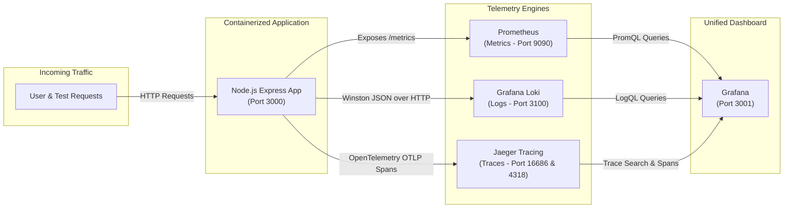

# DevOps Observability Stack

An end-to-end, production-grade cloud observability system implementing the **Three Pillars of Observability** (**Metrics, Logs, and Traces**) for a containerized Node.js Express application.

---

## 📖 Project Overview

Modern distributed software systems are complex and dynamic. When a service experiences an outage or performance degradation, debugging by guessing or manually SSHing into servers is inefficient and prone to error. 

This project demonstrates how to achieve comprehensive observability by collecting, correlating, and visualizing telemetry data across the **Three Pillars of Observability**:



### 🏛️ The Three Pillars of Observability Explained

| Pillar | What it is | Why it matters | Tool Used in Stack |
| :--- | :--- | :--- | :--- |
| **1. Metrics** | Aggregable numeric data measured over time (e.g., requests per second, error rate, memory usage, request duration). | Gives a high-level view of system health, trends, and alerting triggers ("*Is there a problem right now?*"). | **Prometheus** (`prom-client`) |
| **2. Logs** | Timestamped, structured event records detailing what happened at a specific moment in time (e.g., HTTP method, user, status code, error message). | Provides rich contextual details to diagnose individual events and error stack traces ("*Why did it happen?*"). | **Grafana Loki** (`winston` & `winston-loki`) |
| **3. Traces** | Records the complete end-to-end journey of a single request across services, middleware, and handlers using correlated spans. | Pinpoints exact performance bottlenecks and latency hotspots along the execution path ("*Where did the request spend its time?*"). | **Jaeger** (`OpenTelemetry SDK`) |

---

## 🛠️ Tools & Technologies Used

- **Node.js (v20 Alpine)**: Lightweight runtime for the containerized application.
- **Express.js**: Web application framework exposing demo endpoints (`/`, `/slow`, `/error`, `/metrics`).
- **Prometheus**: Time-series database that pulls (scrapes) application metrics every 5 seconds.
- **`prom-client`**: Official Prometheus client library instrumenting custom counters, histograms, and Node.js default system metrics.
- **Grafana Loki**: Horizontally scalable, log aggregation system indexing metadata labels.
- **Winston & Winston-Loki**: Structured JSON logger formatting and streaming logs to both stdout and Loki.
- **Jaeger & OpenTelemetry**: Open standard distributed tracing framework recording HTTP request lifecycles.
- **Grafana**: Central visualization platform pre-provisioned with unified dashboards, Prometheus, Loki, and Jaeger datasources.
- **Docker & Docker Compose**: Declarative container orchestration for one-command deployment.

---

## 📁 Project Directory Structure

```text
devops-observability-stack/
├── app/
│   ├── .dockerignore                            # Ignores node_modules during Docker image builds
│   ├── Dockerfile                               # Lightweight node:20-alpine container specification
│   ├── package.json                             # Application dependencies and startup scripts
│   ├── tracing.js                               # OpenTelemetry Node SDK tracer initialization
│   └── server.js                                # Express web server with routes, metrics, and JSON logger
├── prometheus/
│   ├── .gitkeep
│   └── prometheus.yml                           # Prometheus scrape job targeting app:3000 every 5s
├── grafana/
│   ├── dashboards/
│   │   └── observability-dashboard.json         # Automated dashboard JSON (RPS, Latency, Errors, Logs)
│   └── provisioning/
│       ├── dashboards/
│       │   └── dashboards.yml                   # Auto-imports dashboards from /var/lib/grafana/dashboards
│       └── datasources/
│           └── datasources.yml                  # Auto-provisions Prometheus, Loki & Jaeger datasources
├── screenshots/                                 # Verification screenshots and report deliverables
│   ├── grafana-metrics-dashboard.jpg            # Grafana metrics and error count panel
│   ├── jaeger-ui-home.png                       # Jaeger Web UI home page
│   ├── jaeger-traces-list-slow.png              # Captured trace list for /slow requests
│   └── jaeger-trace-detail-slow.png             # Detailed span timeline breakdown
├── .dockerignore                                # Root Docker ignore file
├── .gitignore                                   # Git ignore rules for node_modules, logs, and artifacts
├── docker-compose.yml                           # Multi-container orchestration (5 connected services)
├── generate-traffic.ps1                         # PowerShell script generating realistic traffic patterns
└── README.md                                    # Project documentation
```

---

## 🚀 How to Run the Stack

### 1. Start all services
From the root of the project directory, run:

```bash
docker compose up --build -d
```

- `--build`: Rebuilds the custom Node.js image with all dependencies.
- `-d`: Starts the containers detached in the background.

### 2. Verify all 5 containers are running
```bash
docker compose ps
```
You will see all five services in the **`Up`** / **`running`** state:
- `observability-app`
- `prometheus`
- `loki`
- `jaeger`
- `grafana`

### 3. Service URLs and Ports Reference

| Service | Host URL | Container Port | Purpose |
| :--- | :--- | :--- | :--- |
| **Demo Application** | [http://localhost:3000](http://localhost:3000) | `3000` | Sample Express app exposing demo routes & `/metrics` |
| **Prometheus UI** | [http://localhost:9090](http://localhost:9090) | `9090` | Scrapes metrics and evaluates PromQL queries |
| **Prometheus Targets** | [http://localhost:9090/targets](http://localhost:9090/targets) | `9090` | Verifies `app` scrape target health (`UP`) |
| **Grafana Dashboard** | [http://localhost:3001](http://localhost:3001) | `3000` | Visual dashboards (User: `admin`, Password: `admin`) |
| **Loki Engine** | [http://localhost:3100](http://localhost:3100) | `3100` | Log ingestion receiver & LogQL query engine |
| **Jaeger Tracing UI** | [http://localhost:16686](http://localhost:16686) | `16686` | Distributed trace search, span viewer, and timeline |
| **Jaeger OTLP HTTP** | [http://localhost:4318](http://localhost:4318) | `4318` | OpenTelemetry OTLP trace collection endpoint |

---

## ⚡ Generating Test Traffic

To populate the metrics, logs, and trace dashboards with real-world activity, run the bundled PowerShell script:

```powershell
.\generate-traffic.ps1
```

### Alternatively, run this direct PowerShell snippet:
```powershell
Write-Host "Sending requests to / and /error..." -ForegroundColor Cyan
1..50 | ForEach-Object {
    Invoke-RestMethod -Uri "http://localhost:3000/" | Out-Null
    try { Invoke-RestMethod -Uri "http://localhost:3000/error" | Out-Null } catch {}
}

Write-Host "Sending 20 concurrent requests to /slow..." -ForegroundColor Yellow
1..20 | ForEach-Object {
    Start-Job -ScriptBlock { Invoke-RestMethod -Uri "http://localhost:3000/slow" } | Out-Null
}
Get-Job | Wait-Job | Remove-Job
Write-Host "Traffic generation finished!" -ForegroundColor Green
```

---

## 📸 Project Verification Screenshots

The [`screenshots/`](./screenshots/) directory contains verified visual captures of all components in action:

| Screenshot Preview | File Name | Description |
| :--- | :--- | :--- |
|  | `grafana-metrics-dashboard.jpg` | **Grafana Dashboard**: Displays real-time requests per second (RPS), average latency calculations, total HTTP 500 count (23 failures captured in bright red), and request distribution by route. |
|  | `jaeger-traces-list-slow.png` | **Jaeger Trace Search**: Scatter plot and trace list confirming 5 captured traces for the `GET /slow` route with latencies between 1.42s and 2.56s. |
|  | `jaeger-trace-detail-slow.png` | **Jaeger Span Timeline**: Deep trace drilldown illustrating the request lifecycle through Express query parsing, initialisation, and the `/slow` request handler. |
|  | `jaeger-ui-home.png` | **Jaeger Web UI**: Home page running on `http://localhost:16686` with service discovery active. |

---

## 🧠 Insights Observed

1. **Correlation Between Latency and Traces**:
   - Prometheus histogram metrics recorded an immediate surge in average response duration on the `/slow` endpoint (averaging ~1.9s).
   - Drilling down into the corresponding Jaeger trace confirmed that 99.9% of the elapsed time was spent inside the Express async handler waiting for the simulated delay, while framework overhead (`expressInit`, `query`) took only microseconds ($\approx 59\mu\text{s}$).

2. **Automated Error Rate Detection**:
   - Out of 50 requests dispatched to `/error`, exactly 23 threw HTTP 500 (~46%), reflecting the stochastic 50% failure rate implemented in code.
   - The Grafana Stat panel instantly turned red, showing an operational alert state without requiring manual threshold recalculations.

3. **Structured Logging Eliminates Guesswork**:
   - Instead of plain text output, Winston emitted JSON logs with fields `method`, `route`, `status`, and `duration`.
   - In Grafana Loki, operators can filter errors instantly using simple LogQL: `{app="nodejs-demo-app"} | json | status = 500`.

4. **Zero-Touch Provisioning (GitOps-ready)**:
   - All dashboards and data sources are declared as code (`datasources.yml`, `dashboards.yml`, `observability-dashboard.json`). 
   - When launching the stack on any machine, the dashboards and data sources are immediately available without any manual UI configuration.

---

## 🛑 How to Stop the Stack

To stop and remove all running containers, networks, and volumes:

```bash
docker compose down
```
