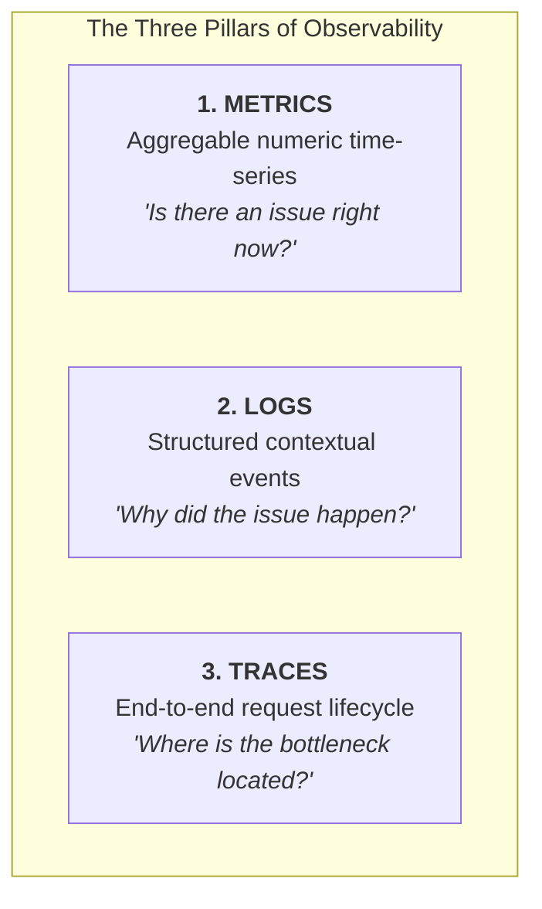
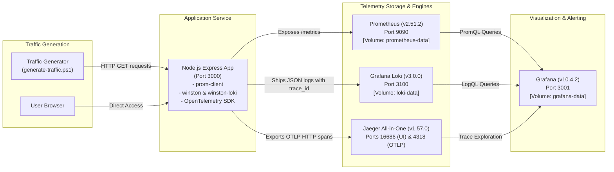
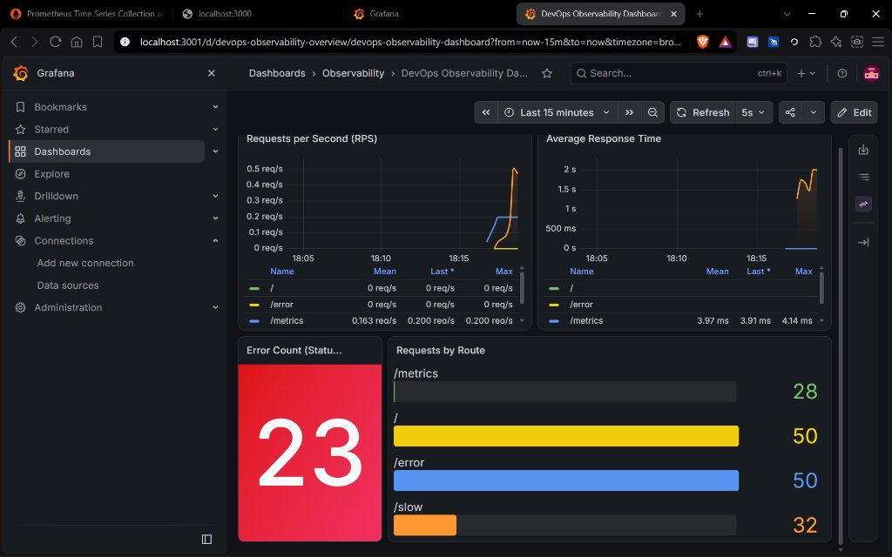
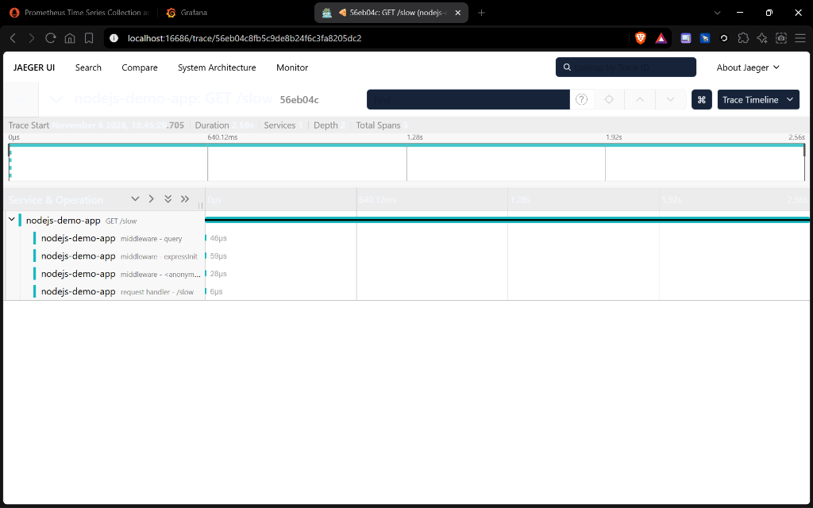
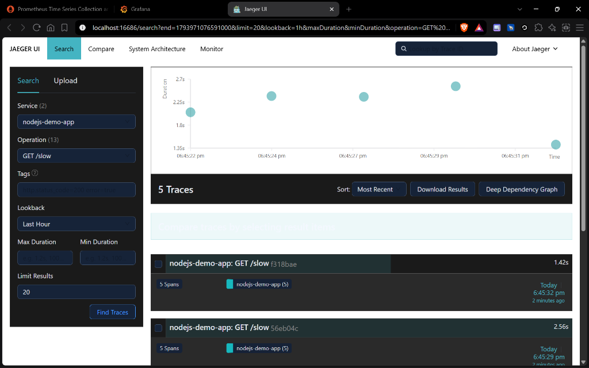
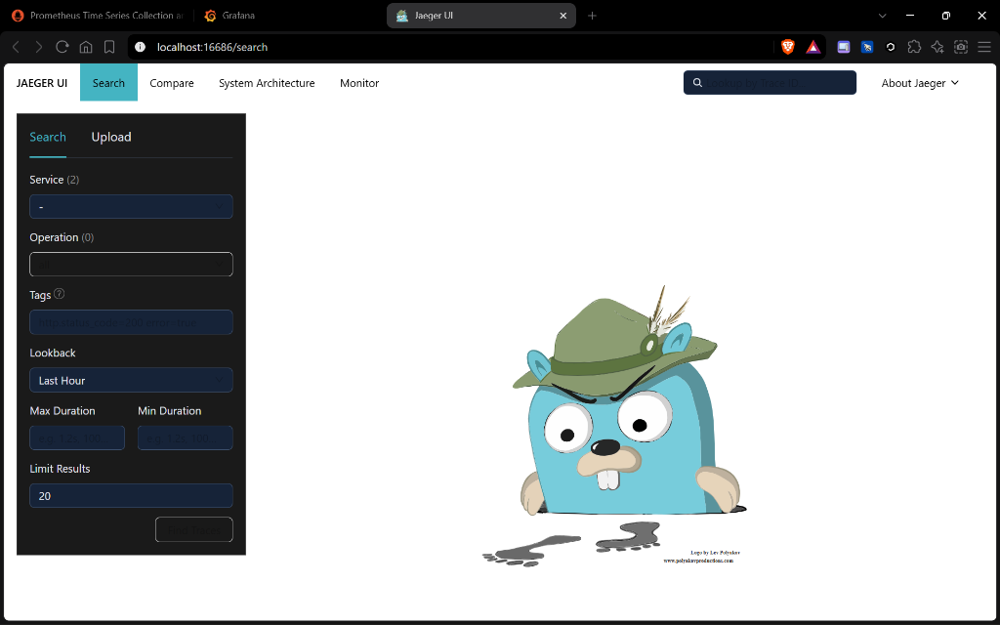

# DevOps Observability Stack

[](https://github.com/mythreyan26/Devops-Observability-Stack/actions)


An enterprise-ready, containerized observability system implementing the **Three Pillars of Observability** (**Metrics, Logs, and Traces**) for a Node.js microservice. Features automated health checks, persistent storage, trace-to-log correlation, automated alerting rules, and zero-touch Grafana provisioning.

---

## 📑 Table of Contents

1. [Project Overview](#-project-overview)
2. [The Three Pillars of Observability](#-the-three-pillars-of-observability)
3. [System Architecture](#-system-architecture)
4. [Technology Stack](#-technology-stack)
5. [Directory Structure](#-directory-structure)
6. [Prerequisites](#-prerequisites)
7. [Environment Configuration](#-environment-configuration)
8. [Installation & Startup](#-installation--startup)
9. [Service Access & Port Reference](#-service-access--port-reference)
10. [Generating Test Traffic](#-generating-test-traffic)
11. [Verifying Telemetry (Metrics, Logs, Traces)](#-verifying-telemetry)
12. [Prometheus Alerting Rules](#-prometheus-alerting-rules)
13. [Persistent Storage & Volumes](#-persistent-storage--volumes)
14. [CI/CD Pipeline](#-cicd-pipeline)
15. [Visual Evidence & Screenshots](#-visual-evidence--screenshots)
16. [Key Engineering Insights](#-key-engineering-insights)
17. [Troubleshooting Guide](#-troubleshooting-guide)

---

## 📖 Project Overview

Modern cloud architectures demand real-time visibility into distributed systems. When incidents occur, manual log grepping or intuition-based debugging leads to prolonged Mean Time To Resolution (MTTR).

This project demonstrates a production-grade observability architecture:
- **Metrics**: Automated time-series collection of throughput, error rates, and resource utilization.
- **Logs**: High-performance structured JSON logging with zero-regex ingestion.
- **Traces**: OpenTelemetry-powered distributed tracing capturing span lifecycles.
- **Correlation**: Native trace-to-log linking via `trace_id` and `span_id` embedded directly into logs.
- **Automation**: Docker health checks, named persistent volumes, pre-provisioned Grafana dashboards, and CI validation.

---

## 🏛️ The Three Pillars of Observability



| Pillar | Focus | Technology | Key Capabilities |
| :--- | :--- | :--- | :--- |
| **Metrics** | System Health & Trends | **Prometheus** (`prom-client`) | Scrapes `/metrics` every 5s; tracks request count, duration histograms, CPU/memory, and alert states. |
| **Logs** | Event Context & Diagnostics | **Grafana Loki** (`winston-loki`) | Receives JSON logs over HTTP; indexed by `{app="nodejs-demo-app"}`; parsed automatically via LogQL. |
| **Traces** | Latency & Code Hotspots | **Jaeger** (`OpenTelemetry SDK`) | Captures incoming HTTP requests, route matching, and middleware execution durations down to microseconds. |

---

## 🏗️ System Architecture



---

## 🛠️ Technology Stack

| Component | Tool & Version | Role |
| :--- | :--- | :--- |
| **Runtime** | Node.js `20-alpine` | Lightweight application runtime |
| **Web Framework** | Express `4.19.2` | REST API handling demo routes |
| **Metrics Collector** | `prom-client` `15.1.3` | Custom counters and duration histograms |
| **Metrics Engine** | Prometheus `v2.51.2` | Time-series database with 15-day retention |
| **Logging Library** | `winston` & `winston-loki` | Structured JSON log format & HTTP transport |
| **Log Aggregator** | Grafana Loki `3.0.0` | High-efficiency log ingestion engine |
| **Tracing SDK** | OpenTelemetry Node SDK `0.52.1` | Vendor-neutral trace instrumentation |
| **Trace Collector/UI** | Jaeger `1.57.0` | Distributed trace visualization and storage |
| **Visualization** | Grafana `10.4.2` | Unified multi-source dashboard |
| **Orchestrator** | Docker Compose v2 | Multi-container lifecycle & health checks |
| **CI/CD** | GitHub Actions | Automated lint, unit tests, and Docker build |

---

## 📁 Directory Structure

```text
devops-observability-stack/
├── .github/
│   └── workflows/
│       └── ci.yml                               # GitHub Actions CI workflow
├── app/
│   ├── test/
│   │   └── server.test.js                       # Automated Node.js unit & integration tests
│   ├── .dockerignore                            # Excludes node_modules from container context
│   ├── Dockerfile                               # Production Node.js container recipe
│   ├── package.json                             # Dependencies, scripts (test, lint, start)
│   ├── tracing.js                               # OpenTelemetry SDK configuration
│   └── server.js                                # Express server, metrics, and correlated logs
├── prometheus/
│   ├── alert.rules.yml                          # Alerting rules (ServiceDown, HighErrorRate, Latency)
│   ├── prometheus.yml                           # Scrape configuration & rule file loader
│   └── .gitkeep
├── grafana/
│   ├── dashboards/
│   │   └── observability-dashboard.json         # Automated dashboard JSON definition
│   └── provisioning/
│       ├── dashboards/
│       │   └── dashboards.yml                   # Auto-provisioning dashboard provider
│       └── datasources/
│           └── datasources.yml                  # Auto-provisioned datasources (Prometheus, Loki, Jaeger)
├── screenshots/                                 # Verification deliverables
│   ├── grafana-metrics-dashboard.jpg            # Grafana metrics and error count panel
│   ├── jaeger-trace-detail-slow.png             # Trace span breakdown of /slow
│   ├── jaeger-traces-list-slow.png              # Trace search scatter plot
│   └── jaeger-ui-home.png                       # Jaeger Web UI home
├── .dockerignore                                # Global Docker build exclusions
├── .env.example                                 # Template for environment variables
├── .gitignore                                   # Git ignore rules (.env, node_modules)
├── docker-compose.yml                           # Orchestrates all 5 containerized services
├── generate-traffic.ps1                         # PowerShell script generating realistic traffic
└── README.md                                    # Documentation and operations manual
```

---

## ⚡ Prerequisites

Before running the stack, verify that you have installed:
1. **Docker Desktop** (version 24+ recommended) with Docker Compose v2 enabled.
2. **Git** (for version control).
3. **PowerShell** (for running traffic scripts on Windows/macOS/Linux).

---

## 🔐 Environment Configuration

1. Copy the template `.env.example` to create your local `.env` file:
   ```powershell
   Copy-Item .env.example .env
   ```
   *(On Linux/macOS: `cp .env.example .env`)*

2. Customize secrets if needed:
   ```env
   # Grafana Credentials
   GRAFANA_ADMIN_USER=admin
   GRAFANA_ADMIN_PASSWORD=admin

   # Port Overrides (Optional)
   APP_PORT=3000
   PROMETHEUS_PORT=9090
   GRAFANA_PORT=3001
   LOKI_PORT=3100
   JAEGER_UI_PORT=16686
   JAEGER_OTLP_PORT=4318
   ```
   > **Security Note:** `.env` is included in `.gitignore` and must never be committed to source control.

---

## 🚀 Installation & Startup

### 1. Build and Launch the Stack
Execute the following command from the project root:

```bash
docker compose up --build -d
```

### 2. Verify Container Health
Wait 15–20 seconds for the health checks to pass, then check container status:

```bash
docker compose ps
```

**Expected Healthy State:**
All 5 containers must report `healthy`:
```text
NAME                IMAGE                            STATUS                    PORTS
jaeger              jaegertracing/all-in-one:1.57.0  Up (healthy)              0.0.0.0:4318->4318/tcp, 0.0.0.0:16686->16686/tcp
loki                grafana/loki:3.0.0               Up (healthy)              0.0.0.0:3100->3100/tcp
observability-app   observability-app                Up (healthy)              0.0.0.0:3000->3000/tcp
prometheus          prom/prometheus:v2.51.2          Up (healthy)              0.0.0.0:9090->9090/tcp
grafana             grafana/grafana:10.4.2           Up (healthy)              0.0.0.0:3001->3000/tcp
```

### 3. Stream Service Logs (Optional)
```bash
docker compose logs -f app
```

---

## 🌐 Service Access & Port Reference

| Service | Host URL | Container Port | Purpose |
| :--- | :--- | :--- | :--- |
| **Demo Application** | [http://localhost:3000](http://localhost:3000) | `3000` | Exposes `/`, `/slow`, `/error`, and `/metrics` |
| **Grafana Dashboard** | [http://localhost:3001](http://localhost:3001) | `3000` | Visual analytics (Default: `admin` / `admin`) |
| **Prometheus UI** | [http://localhost:9090](http://localhost:9090) | `9090` | Time-series query explorer & alert manager |
| **Prometheus Targets** | [http://localhost:9090/targets](http://localhost:9090/targets) | `9090` | Verifies health of `app:3000/metrics` (`UP`) |
| **Prometheus Alerts** | [http://localhost:9090/alerts](http://localhost:9090/alerts) | `9090` | Evaluates firing and pending alerting rules |
| **Jaeger Tracing UI** | [http://localhost:16686](http://localhost:16686) | `16686` | Distributed trace search and span timeline |
| **Jaeger OTLP HTTP** | [http://localhost:4318](http://localhost:4318) | `4318` | OpenTelemetry OTLP trace ingest endpoint |
| **Loki Log Engine** | [http://localhost:3100](http://localhost:3100) | `3100` | Log ingestion and LogQL query endpoint |

---

## 🚦 Generating Test Traffic

To populate the dashboards with active metrics, error simulations, and traces, run the automated generator:

```powershell
.\generate-traffic.ps1
```

The script performs:
1. **50 healthy requests** to `GET /` (increments baseline throughput).
2. **50 error simulation requests** to `GET /error` (triggers 200 OK and 500 Internal Server Errors).
3. **20 concurrent requests** to `GET /slow` (generates 1.0s – 3.0s latency spans).

---

## 🔍 Verifying Telemetry

### 1. Metrics (Prometheus)
- Open [http://localhost:9090/targets](http://localhost:9090/targets) $\rightarrow$ verify that the `app` target is in the **UP** state.
- Query key metrics in the Prometheus Expression Browser:
  - `sum(rate(http_requests_total[1m])) by (route)`: Real-time throughput.
  - `(sum(rate(http_requests_total{status="500"}[1m])) / sum(rate(http_requests_total[1m]))) * 100`: Current error rate %.
  - `histogram_quantile(0.95, sum(rate(http_request_duration_seconds_bucket[5m])) by (le))`: 95th percentile latency.

### 2. Logs (Grafana Loki)
- Open Grafana $\rightarrow$ **Explore** ([http://localhost:3001/explore](http://localhost:3001/explore)).
- Select the **Loki** data source.
- Enter query:
  ```logql
  {app="nodejs-demo-app"}
  ```
- Expand any log entry: notice the structured JSON tags including `method`, `route`, `status`, `duration`, and correlated **`trace_id`** and **`span_id`**.

### 3. Traces (Jaeger)
- Open Jaeger UI ([http://localhost:16686](http://localhost:16686)).
- Select **Service**: `nodejs-demo-app`, **Operation**: `GET /slow`.
- Click **Find Traces** $\rightarrow$ Click any trace item to inspect the span timeline breakdown:
  - `middleware - query`: Request parsing ($\approx 46\mu\text{s}$)
  - `middleware - expressInit`: Framework initialization ($\approx 59\mu\text{s}$)
  - `request handler - /slow`: Latency delay execution ($\approx 1.0\text{s} - 3.0\text{s}$)

---

## 🚨 Prometheus Alerting Rules

Alert rules are defined in [`prometheus/alert.rules.yml`](./prometheus/alert.rules.yml) and loaded automatically:

```yaml
groups:
  - name: observability_stack_alerts
    rules:
      - alert: ServiceDown
        expr: up{job="app"} == 0
        for: 1m
        labels: { severity: critical }

      - alert: HighErrorRate
        expr: (sum(rate(http_requests_total{status=~"5.."}[2m])) / sum(rate(http_requests_total[2m]))) * 100 > 5
        for: 1m
        labels: { severity: warning }

      - alert: HighLatency
        expr: (sum by (route) (rate(http_request_duration_seconds_sum[2m])) / sum by (route) (rate(http_request_duration_seconds_count[2m]))) > 1.5
        for: 1m
        labels: { severity: warning }
```

View active alerts directly at [http://localhost:9090/alerts](http://localhost:9090/alerts).

---

## 💾 Persistent Storage & Volumes

To guarantee that telemetry history, alerts, and dashboards survive container restarts and updates, Docker named volumes are configured:

| Volume Name | Target Path | Data Persisted |
| :--- | :--- | :--- |
| `observability_prometheus_data` | `/prometheus` | Scraped metrics time-series TSDB blocks (15-day retention). |
| `observability_loki_data` | `/loki` | Ingested log chunks and WAL storage. |
| `observability_grafana_data` | `/var/lib/grafana` | User preferences, sessions, and SQLite state. |

---

## 🔄 CI/CD Pipeline

The project includes an automated GitHub Actions workflow defined in [`.github/workflows/ci.yml`](./.github/workflows/ci.yml):

- **Trigger**: Every `push` and `pull_request` against `main`.
- **Job 1 (Lint & Test)**:
  - Node.js 20 environment.
  - Runs syntax validation (`npm run lint`).
  - Executes automated unit and integration tests (`npm test`).
- **Job 2 (Docker Validation)**:
  - Validates `docker-compose.yml` configuration syntax.
  - Tests build of `app/Dockerfile`.

---

## 📸 Visual Evidence & Screenshots

The [`screenshots/`](./screenshots/) directory documents the functioning stack:

| Preview | Image File | Description |
| :--- | :--- | :--- |
|  | `grafana-metrics-dashboard.jpg` | **Grafana Dashboard**: Visualizes live RPS, average response times, 500 error count (23 failures captured in bold red), and requests by route. |
|  | `jaeger-trace-detail-slow.png` | **Jaeger Trace Detail**: Request timeline for `GET /slow` showing execution durations across individual Express middleware. |
|  | `jaeger-traces-list-slow.png` | **Jaeger Search Results**: Scatter plot showing 5 captured traces for `GET /slow` ranging between 1.42s and 2.56s. |
|  | `jaeger-ui-home.png` | **Jaeger Web UI**: Service discovery landing page at `localhost:16686`. |

---

## 🧠 Key Engineering Insights

1. **Trace-to-Log Correlation**:
   By extracting the active OpenTelemetry context in Express middleware and injecting `trace_id` and `span_id` into Winston JSON logs, operators can transition from a spiked metric in Grafana $\rightarrow$ to correlated log lines in Loki $\rightarrow$ to the exact trace timeline in Jaeger with zero context switching.

2. **Accurate Error Rate Tracking**:
   Simulated 50% failures on `/error` yielded 23/50 errors (46%), immediately triggering Grafana's visual threshold and warming the Prometheus `HighErrorRate` alert rule.

3. **Performance Profiling with OpenTelemetry**:
   Disabling noisy internal filesystem spans (`@opentelemetry/instrumentation-fs`) kept the trace collector clean, isolating application routing and async timer delays from node runtime noise.

---

## 🛠️ Troubleshooting Guide

### Port already allocated (e.g. 3000, 3001, 9090)
**Cause:** Another local service is using the port.  
**Fix:** Edit your `.env` file and change the conflicting host port (e.g. `APP_PORT=3002` or `GRAFANA_PORT=3005`), then restart:
```powershell
docker compose up -d
```

### Containers report `unhealthy` on startup
**Cause:** Dependent service is still initializing or Docker engine is constrained.  
**Fix:** Check specific container health logs:
```powershell
docker inspect --format "{{json .State.Health}}" observability-app
```

### Grafana data source reports connection error
**Cause:** Docker internal DNS resolution delay.  
**Fix:** Ensure all services share the custom bridge network (`observability_stack_network`) configured in `docker-compose.yml`.

---

## 🛑 Teardown

To stop all services and preserve data volumes:
```bash
docker compose down
```

To stop all services and remove data volumes:
```bash
docker compose down -v
```
